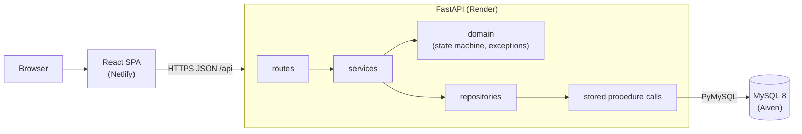

# Architecture

Hosting: Netlify / Render / Aiven MySQL. The Railway config files are kept as an alternative ([deploy-railway.md](deploy-railway.md)).

## Layers

- **routes** (`api/routes/*.py`): HTTP only. Parse and validate input with Pydantic schemas, call a service, return the schema. No business logic.
- **services** (`services/ticket_service.py`): use cases. Validate with the state machine before calling the repository, build `allowedTransitions`.
- **domain** (`domain/`): pure Python. Status enums, `state_machine.py`, `DomainError` hierarchy. No I/O.
- **repositories** (`repositories/ticket_repository.py`): the only place with SQL. Calls the stored procedures and maps MySQL errno 1644 (`MESSAGE_TEXT` = code) to domain exceptions.
- **database**: stored procedures own the transactions, locking, and the `allowed_transition` check.

## Configuration

Environment variables, read by `config.py` (pydantic-settings):

- `DATABASE_URL`: accepts `mysql://` and `mysql+pymysql://`; add `?ssl-mode=REQUIRED` (or `VERIFY_CA` / `VERIFY_IDENTITY`) for TLS.
- `DB_SSL_CA` (PEM text) or `DB_SSL_CA_PATH` (file): CA used to verify the MySQL server when TLS is on.
- `CORS_ORIGINS`
- `LOG_LEVEL`

## Error handling

Exception handlers in `api/errors.py` return RFC 7807 `application/problem+json` with `type`, `title`, `status`, `detail`, `code` and optional `errors`. Unknown errors are logged; the body has a generic detail and no stack trace.

| Source                                                                           | HTTP | `code`                                              |
|----------------------------------------------------------------------------------|------|-----------------------------------------------------|
| `TICKET_NOT_FOUND`, `OPERATOR_NOT_FOUND`                                         | 404  | same as source                                      |
| `CONCURRENCY_CONFLICT`                                                           | 409  | `CONCURRENCY_CONFLICT`                              |
| `INVALID_TRANSITION`, `DIAGNOSIS_REQUIRED`, `COMMENT_REQUIRED`, `COMMENT_EMPTY`, `TICKET_CLOSED` | 422  | same as source                                      |
| Request validation                                                               | 400  | `VALIDATION_ERROR` (with `errors[{field,message}]`) |
| Data rejected by MySQL (errno 3819 CHECK, 1406 data too long)                    | 400  | `VALIDATION_ERROR` (no `errors[]`)                  |
| Framework errors (unknown route, 405, ...)                                       | 404, 405, ... | `HTTP_<status>` (e.g. `HTTP_404`)          |
| Database unavailable                                                             | 503  | `DATABASE_UNAVAILABLE`                              |
| Unknown                                                                          | 500  | `INTERNAL_ERROR`                                    |

Notes:

- A blank comment is rejected at the API with 400 `VALIDATION_ERROR` (Pydantic `min_length=1`). `COMMENT_EMPTY` (422) only appears at service or stored-procedure level.
- `TICKET_CLOSED` is raised when assigning or unassigning a ticket in a final state (`RESOLVED`, `CANCELLED`).
