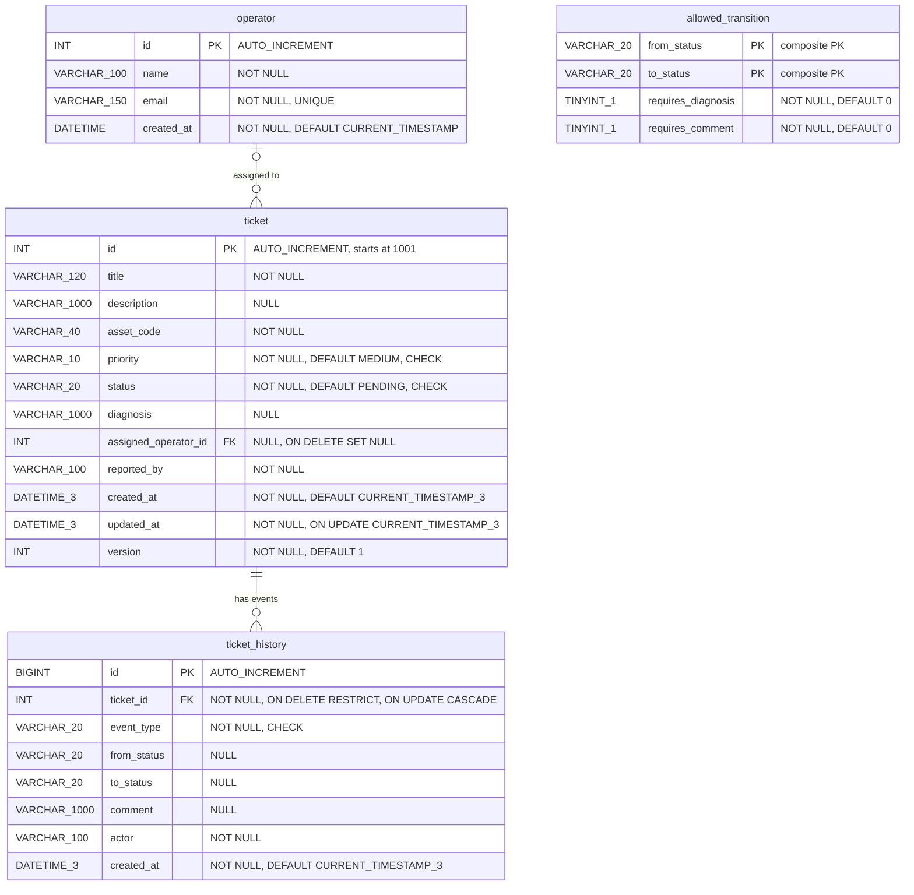

# Entity-Relationship Diagram

MySQL 8, InnoDB, utf8mb4.

Type suffixes are lengths (`VARCHAR_100` = `VARCHAR(100)`, `DATETIME_3` = `DATETIME(3)`), because Mermaid attribute types cannot contain parentheses.

## Notes

- `ticket` to `ticket_history` is 1-N and the history is mandatory: `sp_create_ticket` inserts the ticket and its `CREATED` event in one transaction, so every ticket has at least one event.
- `operator` to `ticket` is optional on both sides: a ticket may be unassigned, an operator may have no tickets.
- `allowed_transition` is a lookup table with no FK. `status` is a closed enum enforced by a `CHECK` constraint on `ticket`, so an FK would add no safety. The table only holds the rules (`requires_diagnosis`, `requires_comment`) read by `sp_change_ticket_status`.
- `event_type` values: `CREATED`, `STATUS_CHANGED`, `COMMENT`, `ASSIGNED`.
- Indexes: `ticket(status)`, `ticket(created_at)`, `ticket(assigned_operator_id)`, `ticket_history(ticket_id, created_at)`, `ticket_history(event_type, created_at)`.

## Integrity rules

- `ticket_history.ticket_id` FK is `ON DELETE RESTRICT`: a ticket with history cannot be deleted.
- History is append-only: app code never runs UPDATE or DELETE on `ticket_history`.
- `CHECK` constraints: `ticket.priority` in (LOW, MEDIUM, HIGH, CRITICAL), `ticket.status` in (PENDING, IN_PROGRESS, RESOLVED, CANCELLED), `ticket_history.event_type` in (CREATED, STATUS_CHANGED, COMMENT, ASSIGNED).
- `ticket.assigned_operator_id` is `ON DELETE SET NULL`: removing an operator unassigns their tickets.
- Optimistic concurrency: `ticket.version` starts at 1 and is incremented on every status change or assignment. The caller sends the expected version; a mismatch raises `CONCURRENCY_CONFLICT`.
- Row lock: `sp_change_ticket_status` reads the ticket with `SELECT ... FOR UPDATE` inside the transaction.
