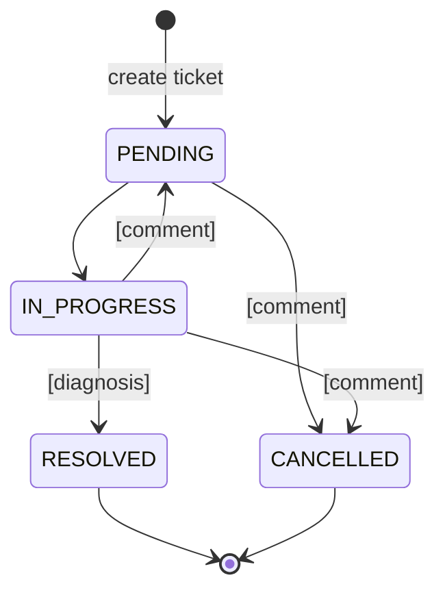

# Ticket State Machine

Statuses: `PENDING`, `IN_PROGRESS`, `RESOLVED`, `CANCELLED`. `RESOLVED` and `CANCELLED` are final.

Guards: `[diagnosis]` = a diagnosis is required, `[comment]` = a comment is required. A value is "present" when it is not null and its trimmed length is greater than 0.

## Transitions

| From        | To          | Requires diagnosis | Requires comment |
|-------------|-------------|--------------------|------------------|
| PENDING     | IN_PROGRESS | no                 | no               |
| PENDING     | CANCELLED   | no                 | yes              |
| IN_PROGRESS | RESOLVED    | yes                | no               |
| IN_PROGRESS | PENDING     | no                 | yes              |
| IN_PROGRESS | CANCELLED   | no                 | yes              |

Any other pair is invalid, including a same-status transition and `PENDING -> RESOLVED`.

## Where it is enforced

Defense in depth, three layers:

1. **Frontend**: shows only the actions listed in the ticket's `allowedTransitions`, and asks for the diagnosis or comment when required. This is UX only.
2. **Service layer**: `domain/state_machine.py` holds `TRANSITIONS` (a mirror of `allowed_transition`) and `validate(from, to, diagnosis, comment)`. `TicketService` calls it before the repository and raises `InvalidTransition`, `DiagnosisRequired` or `CommentRequired` (HTTP 422).
3. **Database**: stored procedure `sp_change_ticket_status` reads `allowed_transition` inside the transaction and signals `INVALID_TRANSITION`, `DIAGNOSIS_REQUIRED` or `COMMENT_REQUIRED`. It also protects against races via `FOR UPDATE` and the `version` check.
